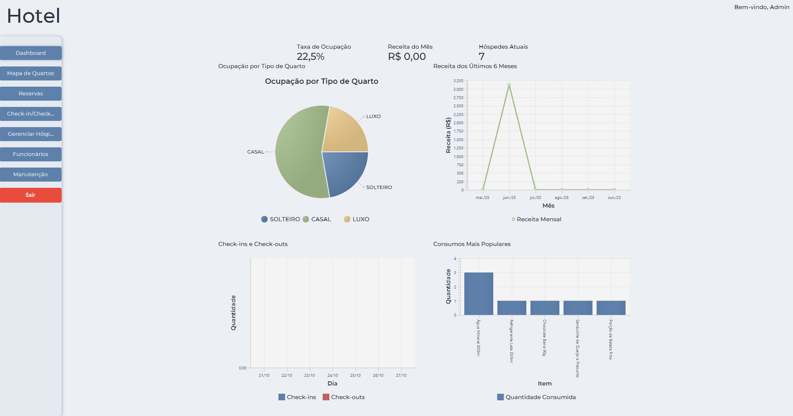

# Sistema de Gerenciamento de Hotel


## Introdução  
Software para automatizar operações diárias de hotéis, incluindo:  
- Controle de reservas e hospedagens  
- Gestão de check-in/check-out  
- Administração de funcionários  
- Monitoramento de manutenção e limpeza de quartos  

### Tecnologias Utilizadas  
- **Backend:** Java  
- **Interface:** JavaFX  
- **Banco de Dados:** MySQL  
- **Arquitetura:** MVC (Model-View-Controller)  
- **Controle de Versão:** GitHub  

---

## Como Executar  
**Pré-requisitos:**  
- Git
- Maven
- Docker/Podman

```bash
# Clonar repositório
git clone https://github.com/marcosschlick/sistema-hotel.git
cd sistema-hotel

# Configurar ambiente
cp .env.example .env

# Editar variáveis (ajuste conforme necessário)
nano .env  # ou seu editor preferido

# Iniciar containers
podman compose up -d   # ou docker compose up -d

# Executar aplicação
mvn clean javafx:run
```

---

## Funcionalidades  
Sistema intuitivo para gestão completa de hotéis:  

### 🛎️ Reservas & Hospedagem  
- Cadastro de hóspedes e reservas  
- Check-in/out automatizados  
- Controle de status de quartos (livre/ocupado/manutenção/sujo)  

### 💰 Operações Financeiras  
- Processamento de pagamentos  
- Relatórios de faturamento e ocupação  

### 👥 Gestão de Equipes  
- Cadastro de funcionários (recepcionistas, camareiras, manutenção)  
- Atribuição de tarefas e supervisão  

### 🧹 Manutenção & Limpeza  
- Atualização em tempo real do status de limpeza  
- Registro de observações sobre quartos  
- Criação e acompanhamento de ordens de serviço  
